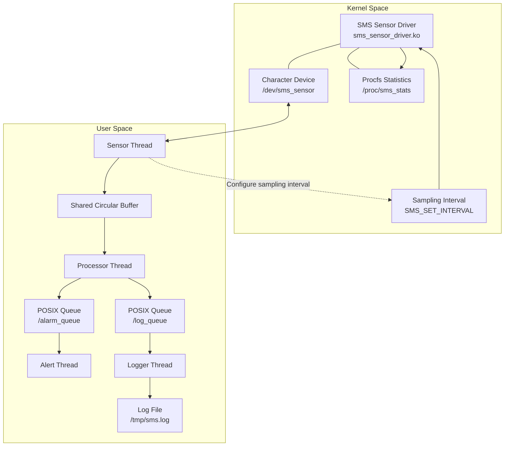
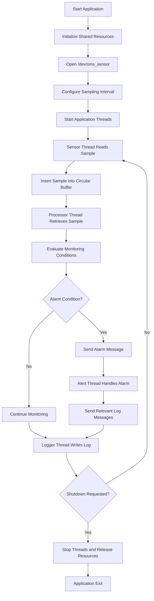
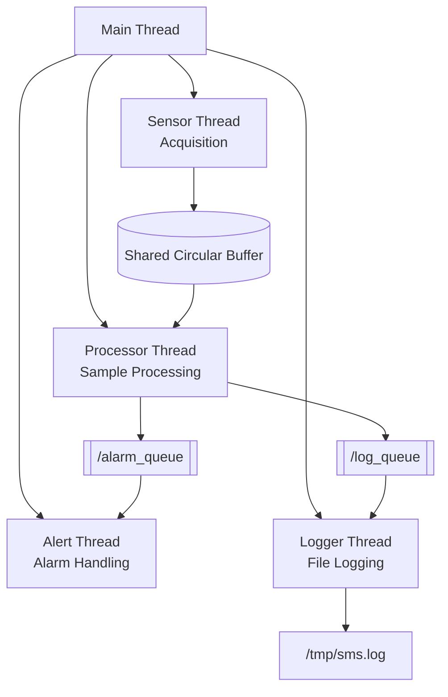
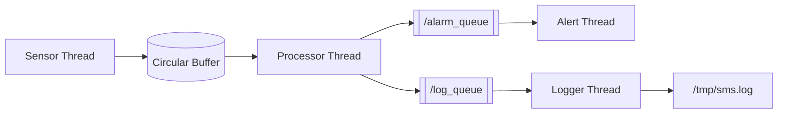
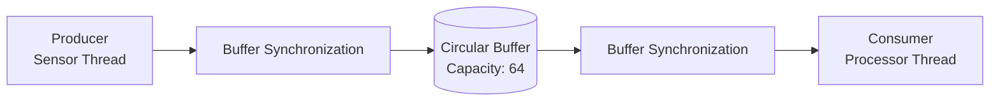
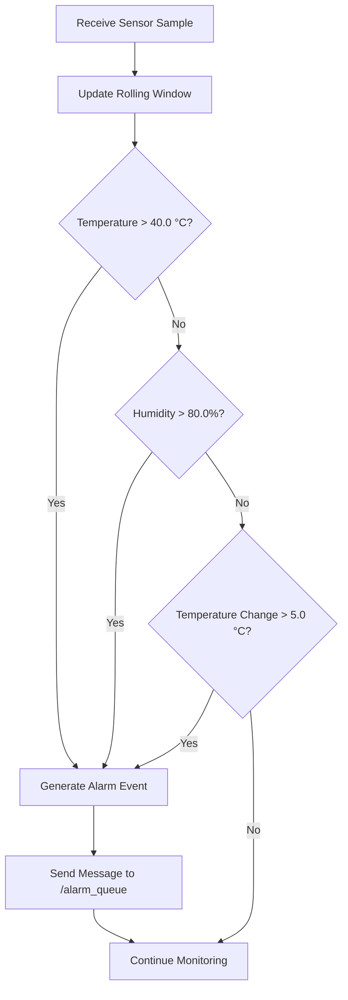
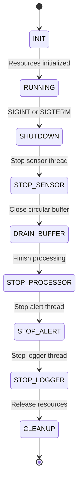
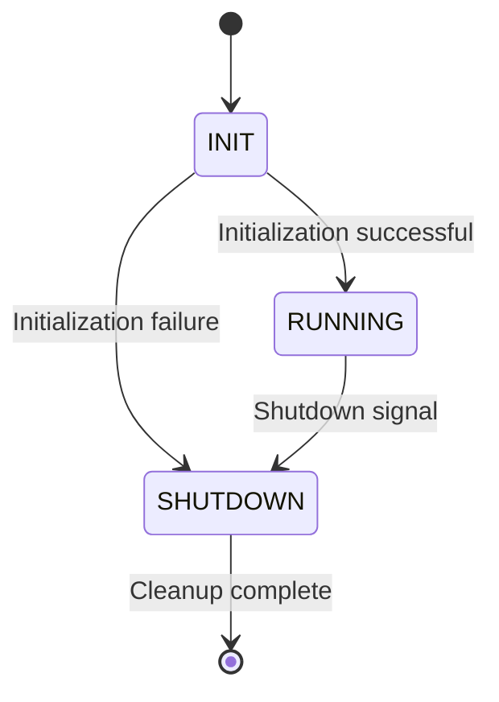

<div align="center">

# Embedded Linux Assignment 02
### Simulated Temperature and Humidity Monitoring System

A multi-threaded embedded Linux application integrating a custom kernel sensor driver, real-time scheduling, inter-thread communication, and system logging.


**Course:** Embedded Linux
**Student:** Tran Nguyen Hai Dang
**Student ID:** SE202009

</div>

---

## Table of Contents

- [1. Project Overview](#1-project-overview)
- [2. Objectives](#2-objectives)
- [3. Development Environment](#3-development-environment)
- [4. System Architecture](#4-system-architecture)
- [5. Data Acquisition and Processing Workflow](#5-data-acquisition-and-processing-workflow)
- [6. Kernel Sensor Driver](#6-kernel-sensor-driver)
- [7. Multi-Threaded Application](#7-multi-threaded-application)
- [8. Inter-Thread Communication](#8-inter-thread-communication)
- [9. Circular Buffer and Synchronization](#9-circular-buffer-and-synchronization)
- [10. Alarm Detection](#10-alarm-detection)
- [11. Logging and Shutdown](#11-logging-and-shutdown)
- [12. Application State Machine](#12-application-state-machine)
- [13. Repository Structure](#13-repository-structure)
- [14. Build Instructions](#14-build-instructions)
- [15. Running the System in QEMU](#15-running-the-system-in-qemu)
- [16. Verification and Test Results](#16-verification-and-test-results)
- [17. Design Decisions](#17-design-decisions)
- [18. Real-Time Considerations](#18-real-time-considerations)
- [19. Limitations and Future Improvements](#19-limitations-and-future-improvements)
- [20. References](#20-references)

---

## 1. Project Overview

This project implements an embedded temperature and humidity monitoring system on Embedded Linux.

The system consists of a custom Linux kernel module that simulates a sensor and a multi-threaded user-space application that acquires, processes, monitors, and logs sensor readings.

The kernel module exposes a character device interface for sensor data acquisition and a procfs interface for monitoring driver statistics. The user-space application uses POSIX threads, a shared circular buffer, and POSIX message queues to coordinate sensor acquisition, data processing, alarm detection, and logging.

The system is designed to run on an ARMv7 virtual platform using QEMU and a Linux 5.15 kernel.

### Main Features

- Custom Linux kernel module for simulated temperature and humidity measurements.
- Character device interface at `/dev/sms_sensor`.
- Driver statistics exposed through `/proc/sms_stats`.
- Configurable sensor sampling interval through an ioctl interface.
- Multi-threaded user-space application using POSIX threads.
- Shared circular buffer for sensor data.
- POSIX message queues for alarm and logging communication.
- Threshold-based alarm detection.
- Persistent application logging to `/tmp/sms.log`.
- Signal-driven, orderly application shutdown.
- ARM cross-compilation and QEMU-based execution.

---

## 2. Objectives

The project demonstrates the integration of Linux kernel-space and user-space components in an embedded monitoring application.

The main objectives are:

1. Implement a custom character device driver.
2. Expose sensor measurements and driver statistics to user space.
3. Configure the sensor sampling interval through an ioctl command.
4. Implement a multi-threaded application with separate responsibilities.
5. Synchronize access to shared sensor data.
6. Use POSIX message queues for inter-thread communication.
7. Detect abnormal temperature, humidity, and temperature changes.
8. Record sensor readings and alarm events in a log file.
9. Support controlled shutdown of application threads.
10. Build and execute the application in an ARM-based QEMU environment.

---

## 3. Development Environment

| Component | Configuration |
|---|---|
| Host operating system | Ubuntu Linux |
| Target architecture | ARMv7 |
| Linux kernel | 5.15.0 |
| Virtual platform | QEMU `vexpress-a9` |
| Kernel driver language | C |
| Application language | C |
| Build system | GNU Make |
| Kernel module build | Linux Kbuild |
| Application threading | POSIX Threads |
| Inter-thread messaging | POSIX Message Queues |
| Sensor device | `/dev/sms_sensor` |
| Driver statistics | `/proc/sms_stats` |
| Application log | `/tmp/sms.log` |

The kernel module must be built against the appropriate kernel build tree for the target architecture. The user-space application must also be compiled for the target architecture before being included in the target root filesystem.

---

## 4. System Architecture

The system is divided into two major execution domains:

- **Kernel space:** sensor simulation, character device operations, ioctl configuration, and driver statistics.
- **User space:** sensor acquisition, buffering, processing, alarm detection, and logging.

### 4.1 High-Level Architecture



### 4.2 Component Responsibilities

| Component | Responsibility |
|---|---|
| Sensor driver | Simulates temperature and humidity readings |
| Character device | Provides a user-space interface for sensor acquisition |
| Procfs interface | Exposes driver statistics |
| Sensor thread | Reads sensor data and inserts samples into the circular buffer |
| Circular buffer | Temporarily stores samples for processing |
| Processor thread | Processes samples and evaluates monitoring conditions |
| Alert thread | Handles alarm notifications |
| Logger thread | Writes application events and sensor data to a log file |
| POSIX message queues | Transfer alarm and logging messages between threads |
| Main application | Initializes resources, manages threads, and coordinates shutdown |

---

## 5. Data Acquisition and Processing Workflow

A typical sensor sample follows this processing path.



### 5.1 Sample Data Format

The driver returns sensor readings in CSV format:

```text
timestamp_ms,temperature,humidity
```

Example:

```text
53618,32.4,73.8
```

The fields represent:

| Field | Description |
|---|---|
| `timestamp_ms` | Sensor timestamp in milliseconds |
| `temperature` | Simulated temperature in degrees Celsius |
| `humidity` | Simulated relative humidity percentage |

Temperature and humidity values are simulated by the kernel driver; they are not measurements from physical hardware.

---

## 6. Kernel Sensor Driver

### 6.1 Driver Overview

The custom driver is implemented in `driver/sms_sensor_driver.c` and provides a simulated temperature and humidity sensor.

It exposes a character device, an ioctl interface, and a procfs statistics entry.

### 6.2 Device Interface

| Interface | Purpose |
|---|---|
| `/dev/sms_sensor` | Read simulated sensor samples |
| `/proc/sms_stats` | Inspect driver statistics |
| `SMS_SET_INTERVAL` | Configure the sensor sampling interval |

The character device is registered dynamically by the driver. The major number observed during testing was `248`; this value should not be assumed to remain fixed across all environments.

### 6.3 Sampling Interval

The driver supports a configurable sampling interval.

| Property | Value |
|---|---:|
| Default interval | 100 ms |
| Minimum accepted interval | 1 ms |
| Maximum accepted interval | 60000 ms |
| Configuration mechanism | ioctl |
| ioctl command | `SMS_SET_INTERVAL` |

The user-space application can request an interval using the driver's ioctl interface.

Invalid values outside the accepted range should be rejected by the driver.

### 6.4 Driver Statistics

The procfs entry `/proc/sms_stats` exposes information such as:

- Number of sensor reads.
- Most recently reported temperature.
- Most recently reported humidity.
- Driver uptime.
- Configured sampling interval.
- Timestamp associated with the latest read.

Example:

```text
read_count: 40
last_temperature: 37.1
last_humidity: 61.9
uptime_seconds: 120
interval_ms: 500
last_read_ms: 33000
```

The values above are illustrative; actual values depend on the runtime session.

### 6.5 Driver Source Files

```text
driver/
├── Makefile
├── sms_sensor.h
├── sms_sensor_driver.c
└── sms_sensor_driver.ko
```

The `.ko` file is the compiled kernel module for the target kernel and architecture.

---

## 7. Multi-Threaded Application

The user-space application is implemented in the `app/` directory.

Its design separates sensor acquisition, data processing, alarm handling, and logging into dedicated threads.

### 7.1 Thread Architecture



### 7.2 Sensor Thread

The sensor thread is responsible for:

1. Opening the sensor device.
2. Configuring the sampling interval.
3. Reading sensor samples.
4. Converting the returned data into the application's sample representation.
5. Inserting samples into the shared circular buffer.
6. Reporting buffer overflow or sample-drop warnings where applicable.

The sensor thread uses `SCHED_FIFO` with priority `50` in the implemented configuration.

Real-time scheduling behavior depends on kernel configuration, process privileges, and the runtime environment.

### 7.3 Processor Thread

The processor thread retrieves samples from the circular buffer and evaluates them against the application's monitoring conditions.

Its responsibilities include:

- Consuming sensor samples.
- Maintaining the rolling sample window.
- Evaluating temperature and humidity thresholds.
- Detecting significant temperature changes.
- Sending alarm messages when required.
- Forwarding relevant events to the logging subsystem.

### 7.4 Alert Thread

The alert thread receives alarm messages through `/alarm_queue`.

It handles alarm events independently of the sensor acquisition path, allowing the application to separate data acquisition from alert processing.

### 7.5 Logger Thread

The logger thread receives logging messages through `/log_queue` and writes them to:

```text
/tmp/sms.log
```

The implementation includes periodic log flushing and a maximum log-file size of approximately 1 MiB.

The logger operates independently of the sensor thread, reducing the amount of file I/O performed directly in the acquisition path.

---

## 8. Inter-Thread Communication

The application uses a shared circular buffer and POSIX message queues.

### 8.1 Communication Mechanisms

| Mechanism | Name | Purpose |
|---|---|---|
| Shared data structure | Circular buffer | Transfers sensor samples from the sensor thread to the processor thread |
| POSIX message queue | `/alarm_queue` | Transfers alarm notifications |
| POSIX message queue | `/log_queue` | Transfers logging messages |

### 8.2 Communication Flow



### 8.3 Design Rationale

The circular buffer is appropriate for the producer-consumer relationship between the sensor and processor threads.

POSIX message queues provide a separate communication path for alarm and logging messages. This keeps notification handling and file output separate from the main sample acquisition flow.

---

## 9. Circular Buffer and Synchronization

The application uses a bounded circular buffer to store sensor samples before processing.

### 9.1 Buffer Properties

| Property | Description |
|---|---|
| Capacity | 64 samples |
| Producer | Sensor thread |
| Consumer | Processor thread |
| Synchronization | Thread synchronization primitives |
| Full-buffer behavior | Sample insertion can fail when no space is available |

The buffer uses a fixed capacity to avoid unbounded growth in memory consumption.

### 9.2 Producer-Consumer Model



The sensor thread produces samples, while the processor thread consumes them.

Synchronization is required because both threads access shared buffer state.

### 9.3 Buffer Overflow

If the buffer is full, a new sample may not be inserted. The application reports a warning for a failed insertion caused by a full buffer.

This policy prevents the sensor thread from silently treating a failed insertion as a successful operation.

Buffer capacity and consumer throughput should be evaluated together when selecting the sampling interval.

---

## 10. Alarm Detection

The processor evaluates samples against configured monitoring conditions.

The implemented threshold values are represented in tenths to preserve one decimal place without requiring floating-point storage for the threshold comparisons.

### 10.1 Configured Thresholds

| Condition | Threshold |
|---|---:|
| High temperature | 40.0 °C |
| High humidity | 80.0% |
| Significant temperature change | 5.0 °C |

The temperature-change threshold is equivalent to `50` when represented in tenths of a degree.

### 10.2 Alarm Workflow



The diagram illustrates the main threshold-evaluation concept. The actual implementation determines the evaluation details and message contents.

---

## 11. Logging and Shutdown

### 11.1 Logging

Application logs are written to:

```text
/tmp/sms.log
```

The log may contain sensor samples, alarm notifications, and warnings.

Example log entries:

```text
SAMPLE timestamp_ms=...
WARNING: Alarm: ...
```

Actual message formats depend on the event and the running application version.

The logger thread processes messages separately from the sensor acquisition thread.

### 11.2 Graceful Shutdown

The application handles `SIGINT` and `SIGTERM` to initiate orderly shutdown.

The shutdown procedure coordinates the sensor, processor, alert, and logger threads and releases shared resources.

The implemented shutdown sequence is conceptually:

1. Request the sensor thread to stop.
2. Join the sensor thread.
3. Close the circular buffer to signal that no more samples will be produced.
4. Allow the processor thread to finish and join it.
5. Stop and join the alert thread.
6. Stop and join the logger thread.
7. Release remaining application resources.
8. Exit the application.

This ordering is intended to prevent producers from continuing to send data after their consumers have stopped.

### 11.3 Shutdown State Diagram



A successful shutdown should terminate the application and allow pending log messages to be handled according to the logger's shutdown logic.

---

## 12. Application State Machine

The application follows three main lifecycle states.

| State | Description |
|---|---|
| `INIT` | Initialize resources, communication channels, and threads |
| `RUNNING` | Acquire samples, process data, detect alarms, and log events |
| `SHUTDOWN` | Stop threads, handle pending work, and release resources |



The state machine provides a high-level description of the application lifecycle. Individual thread states and error paths are handled by the corresponding implementation.

---

## 13. Repository Structure

The main project structure is:

```text
asm2_work/task1_work/
├── README.md
├── .gitignore
├── boot_qemu.sh
│
├── driver/
│   ├── Makefile
│   ├── sms_sensor.h
│   ├── sms_sensor_driver.c
│   └── sms_sensor_driver.ko
│
├── app/
│   ├── Makefile
│   ├── sms_app.c
│   ├── sms_ipc.h
│   ├── sensor_thread.c
│   ├── sensor_thread.h
│   ├── processor_thread.c
│   ├── processor_thread.h
│   ├── alert_thread.c
│   ├── alert_thread.h
│   ├── logger_thread.c
│   ├── logger_thread.h
│   ├── circular_buffer.c
│   ├── circular_buffer.h
│   └── sms_app
│
├── tests/
│   ├── test_circular_buffer.c
│   └── test_sms_ioctl.c
│
├── demo/
│   ├── benchmark_results.txt
│   ├── demo_results.txt
│   └── demo_script.txt
│
└── output/
    └── initramfs_asgn2_app.cpio.gz
```

The exact contents may vary depending on which generated binaries and build artifacts are retained in the repository.

The `rootfs_work/` directory is a working directory used while preparing the initramfs. It is not required as a tracked source directory when the final initramfs image is included.

---

## 14. Build Instructions

### 14.1 Prerequisites

The build environment requires:

- GNU Make.
- GCC for native application builds.
- An ARM cross-compiler for target application builds.
- Linux kernel build files matching the target kernel.
- QEMU system emulation for ARM.

The ARM toolchain used in the development environment is:

```text
arm-linux-gnueabihf-gcc
```

### 14.2 Build the Kernel Module

From the project root:

```bash
cd driver
make
```

Confirm that the module was generated:

```bash
ls -lh sms_sensor_driver.ko
```

Inspect the module metadata:

```bash
modinfo sms_sensor_driver.ko
```

The module must match the target kernel's architecture and build configuration.

### 14.3 Build the Application for ARM

From the project root:

```bash
cd app
make clean
make
```

Check the resulting executable:

```bash
file sms_app
```

The output should identify an ARM executable suitable for the target environment.

### 14.4 Build a Native Version

For host-side development and testing:

```bash
cd app
make clean
make native
```

A native build is useful for testing application logic on the host. It does not replace testing the ARM build in QEMU.

If both host and ARM builds are required, clean the previous build before switching targets so that incompatible object files are not reused.

### 14.5 Inspect the Initramfs

From the project root:

```bash
ls -lh output/initramfs_asgn2_app.cpio.gz
file output/initramfs_asgn2_app.cpio.gz
```

The initramfs should contain the application, required runtime libraries, and the kernel module.

---

## 15. Running the System in QEMU

### 15.1 Boot the Target

From the project root:

```bash
chmod +x boot_qemu.sh
./boot_qemu.sh
```

The script is intended to boot the ARM system using QEMU's `vexpress-a9` machine, the Linux 5.15 kernel, the matching device tree, and the prepared initramfs.

The script assumes the required kernel and device tree are available at the paths configured in the script. Update those paths if your environment differs.

### 15.2 Verify the Sensor Device

After the guest Linux system has booted, check the device:

```sh
ls -l /dev/sms_sensor
```

The device should exist after the driver has been loaded and registered successfully.

### 15.3 Inspect Driver Statistics

```sh
cat /proc/sms_stats
```

This displays the sensor driver's current statistics.

### 15.4 Run the Application

The application supports the following command-line options:

| Option | Description | Default |
|---|---|---|
| `-i interval_ms` | Set the sampling interval in milliseconds | `500` |
| `-d device_path` | Specify the sensor device path | `/dev/sms_sensor` |

Run the application using the default sensor device and a 500 ms interval:

```sh
/usr/bin/sms_app -i 500 -d /dev/sms_sensor
```

The command assumes that the application is installed at `/usr/bin/sms_app` in the guest filesystem.

### 15.5 Monitor Application Logs

In the guest system, inspect the log file:

```sh
tail -f /tmp/sms.log
```

To inspect the most recent entries:

```sh
tail -n 50 /tmp/sms.log
```

### 15.6 Stop the Application

Press `Ctrl+C` if the application is running in the foreground.

The application should initiate its graceful shutdown procedure in response to `SIGINT`.

---

## 16. Verification and Test Results

Testing was performed during development to verify the kernel driver, application behavior, and shutdown handling.

Results depend on the test environment, kernel configuration, and runtime conditions.

### 16.1 Driver Verification

The following driver behaviors were tested:

| Test | Expected behavior | Recorded outcome |
|---|---|---|
| Read sensor device | Return a simulated sensor sample | Passed during development |
| Read procfs statistics | Expose driver counters and current state | Passed during development |
| Set interval to 200 ms | Accept a valid interval | Passed during development |
| Set interval to 0 ms | Reject an invalid interval | Rejected with `EINVAL` |
| Set interval to 60001 ms | Reject an out-of-range interval | Rejected with `EINVAL` |
| Restore interval to 100 ms | Accept a valid interval | Passed during development |

These results reflect the development tests performed; they are not a guarantee for every kernel configuration.

### 16.2 Application Verification

The application was tested for:

- Successful compilation for native and ARM targets.
- Sensor sample acquisition.
- Sample processing and alarm generation.
- Log file generation.
- Graceful shutdown following `SIGINT`.
- Coordination of the processor, alert, and logger threads during shutdown.

One recorded clean-shutdown run produced 40 sample log entries and 38 alarm warning entries. These are observations from that run, not fixed expected counts.

### 16.3 Circular Buffer and ioctl Tests

The repository includes the following test sources:

```text
tests/test_circular_buffer.c
tests/test_sms_ioctl.c
```

The circular buffer test is intended to validate buffer behavior, while the ioctl test exercises sensor interval configuration.

Build and run each test according to the associated source and build setup. A test result should be reported as passed only when the test has actually been executed successfully in the relevant environment.

### 16.4 Benchmark Artifacts

Recorded benchmark and demonstration artifacts are stored in:

```text
demo/benchmark_results.txt
demo/demo_results.txt
demo/demo_script.txt
```

One recorded benchmark run contained 1642 samples at a configured 100 ms sampling interval. The recorded timing statistics were:

| Metric | Recorded value |
|---|---:|
| Sample count | 1642 |
| Configured interval | 100 ms |
| Minimum reported jitter | 4115 µs |
| Mean reported jitter | 5493.395 µs |
| Maximum reported jitter | 9000 µs |
| Standard deviation | 527.422 µs |

**Measurement note:** These values are from a particular benchmark run. The reported jitter is based on the implementation's timing comparison between read completion and a scheduled sampling deadline. It should not be interpreted as a pure scheduler wake-up latency measurement.

Results obtained in QEMU are affected by the host operating system, emulator scheduling, virtual hardware, and other runtime activity. They should not be treated as measurements of physical hardware performance.

---

## 17. Design Decisions

### 17.1 Kernel-Space Sensor Simulation

The simulated sensor is implemented as a kernel module rather than embedded directly into the user-space application.

This provides practical experience with Linux character devices, ioctl operations, and procfs interfaces while keeping sensor access behind a kernel-space boundary.

### 17.2 Circular Buffer for Sample Transfer

A bounded circular buffer is used to transfer samples between the producer and consumer threads.

Compared with an unbounded collection, a fixed-capacity buffer makes memory usage more predictable. Its capacity must still be sufficient for the expected acquisition and processing rates.

### 17.3 Separate Alert and Logging Threads

Alarm handling and logging are separated from sample acquisition.

This modular structure makes the application easier to maintain and prevents file output from becoming part of the sensor thread's primary responsibility.

### 17.4 POSIX Message Queues

POSIX message queues provide separate communication channels for alarm and logging messages.

This design allows each consumer to process its messages independently. Queue capacity and failure behavior must be considered because a bounded queue can become full if messages are produced faster than they are consumed.

### 17.5 Explicit Shutdown Coordination

The application coordinates thread termination instead of terminating all threads immediately when a signal arrives.

Stopping producers before their consumers helps avoid continued data production during teardown and supports orderly resource cleanup.

---

## 18. Real-Time Considerations

The project includes real-time-oriented design elements, including a sensor thread configured with `SCHED_FIFO` priority 50.

However, real-time scheduling policy alone does not guarantee deterministic sampling or bounded end-to-end latency.

The observed timing behavior depends on several factors:

- Kernel scheduling configuration.
- Process privileges and scheduling permissions.
- Host operating system activity.
- QEMU emulation overhead.
- Sensor read and driver timing behavior.
- Circular buffer contention.
- Message queue congestion.
- Logging and other background activity.

For a more complete real-time evaluation, the following should be measured and documented:

1. Expected sampling deadline and actual wake-up time.
2. Minimum, average, maximum, and P99 wake-up jitter.
3. Histogram of jitter values.
4. Comparison between `SCHED_FIFO` and `SCHED_OTHER`.
5. Behavior under different sampling intervals.
6. Memory-locking behavior, if `mlockall()` is implemented.
7. Absolute-time scheduling behavior, if `clock_nanosleep()` with `TIMER_ABSTIME` is implemented.

These measurements should use clearly defined timestamps and distinguish wake-up jitter from sensor-read completion latency.

The existence of a real-time scheduling policy should not be taken as evidence that all of these measurements or mechanisms are already implemented.

---

## 19. Limitations and Future Improvements

Potential improvements include:

- Implementing and verifying absolute-time periodic scheduling with `clock_nanosleep()`.
- Evaluating `mlockall()` and memory residency where supported.
- Measuring wake-up jitter separately from sensor-read latency.
- Comparing `SCHED_FIFO` and `SCHED_OTHER` using the same benchmark methodology.
- Reporting P99 jitter and a timing histogram.
- Measuring CPU and memory usage at multiple sampling intervals.
- Expanding automated tests for buffer-full conditions and queue failures.
- Improving error recovery for driver and IPC initialization failures.
- Adding a repeatable benchmark script with documented measurement definitions.
- Validating behavior on physical hardware in addition to QEMU.

These are improvement areas, not claims that the corresponding functionality is already complete.

---

## 20. References

- [Linux Kernel Documentation](https://docs.kernel.org/)
- [Linux Kernel Device Drivers](https://docs.kernel.org/driver-api/)
- [Linux Kernel Kbuild Documentation](https://docs.kernel.org/kbuild/)
- [Linux man-pages: pthreads](https://man7.org/linux/man-pages/man7/pthreads.7.html)
- [Linux man-pages: mq_overview](https://man7.org/linux/man-pages/man7/mq_overview.7.html)
- [Linux man-pages: sched](https://man7.org/linux/man-pages/man7/sched.7.html)
- [QEMU Documentation](https://www.qemu.org/docs/master/)

---

<div align="center">

**Embedded Linux Assignment 02**
Tran Nguyen Hai Dang · SE202009

*ARMv7 · Linux Kernel 5.15 · QEMU · POSIX Threads*

</div>
